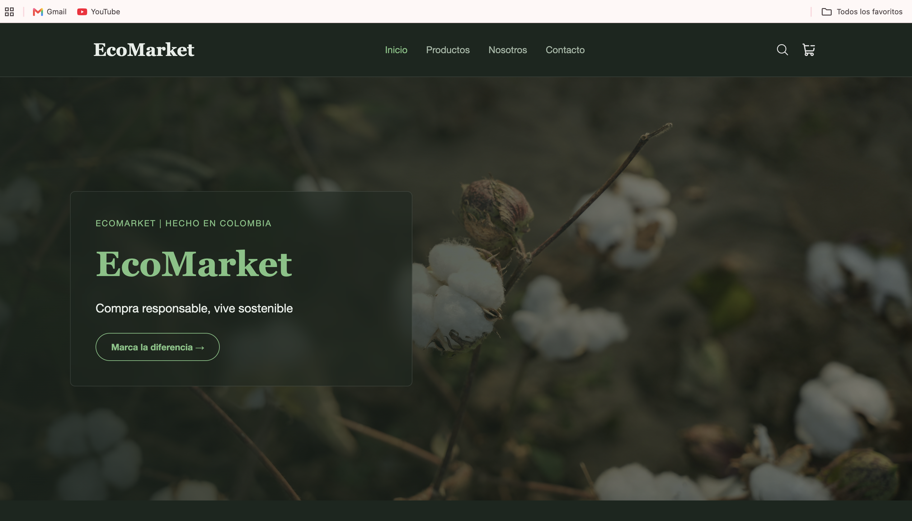
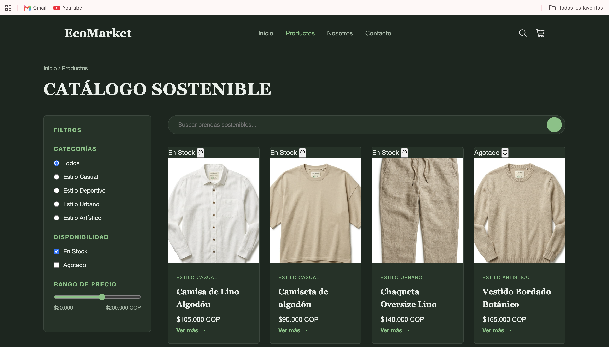
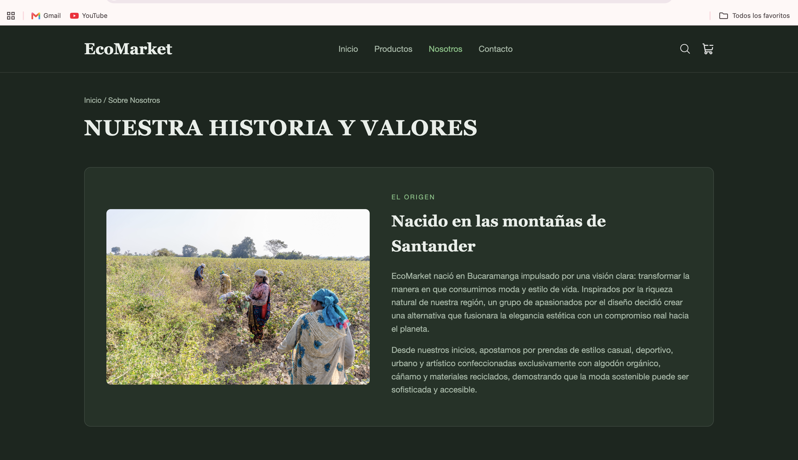
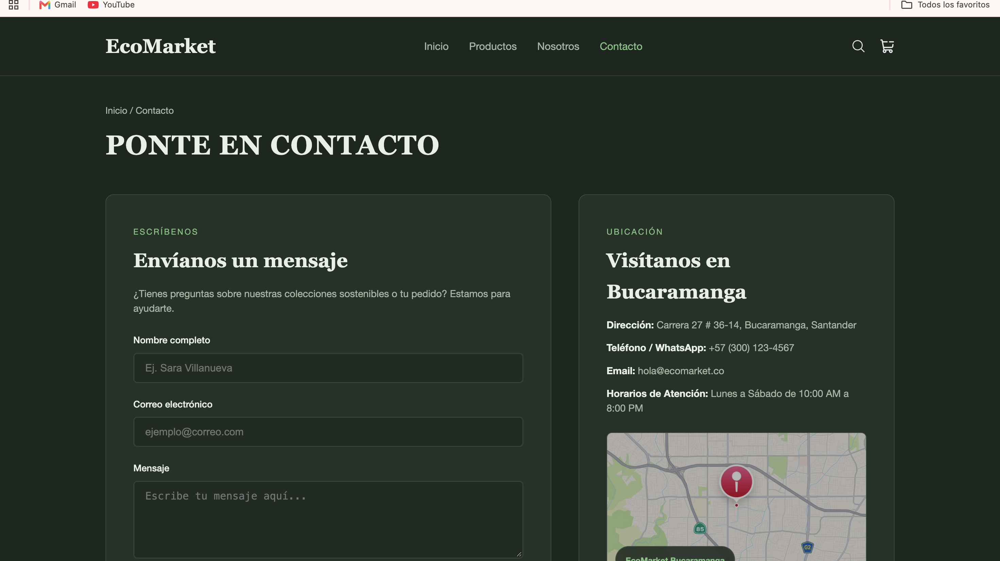

# 🌿 EcoMarket - E-commerce de Moda Sostenible

EcoMarket es una plataforma web de comercio electrónico enfocada en la comercialización de ropa sostenible elaborada con algodón orgánico, cáñamo y materiales reciclados en Bucaramanga, Santander. El proyecto implementa una experiencia de usuario moderna, limpia y accesible con una estética botánica *dark mode*, construida bajo la metodología **Mobile-First** e interactividad nativa mediante **CSS puro**.

---

## 📋 Tabla de Contenidos
1. [Descripción del Proyecto](#-descripción-del-proyecto)
2. [Instrucciones de Visualización](#-instrucciones-de-visualización)
3. [Tecnologías Utilizadas](#-tecnologías-utilizadas)
4. [Estructura del Proyecto](#-estructura-del-proyecto)
5. [Capturas de Pantalla (Móvil y Escritorio)](#-capturas-de-pantalla)

---

## 📝 Descripción del Proyecto

EcoMarket busca concientizar e incentivar el consumo responsable de ropa de alta calidad a través de una interfaz interactiva y dinámica. 

### Secciones Desarrolladas:
* **Inicio (`index.html`)**: Banner principal (*Hero Section*) con llamado a la acción, carrusel/malla de productos destacados y navegación estructurada.
* **Catálogo de Productos (`views/productos.html`)**: Grid responsivo con 20 productos de moda sostenible. Incluye una barra lateral (*sticky*) con filtrado en tiempo real por categoría (*Casual, Deportivo, Urbano, Artístico*) y disponibilidad (*En Stock / Agotado*), buscador y paginación.
* **Sobre Nosotros (`views/sobre-nosotros.html`)**: Historia del origen de la marca en Santander desarrollada con Flexbox, lista de principios ecológicos y carrusel de testimonios interactivo con animaciones.
* **Contacto (`views/contacto.html`)**: Formulario de contacto inteligente con feedback de validación en tiempo real, mapa de ubicación estilizado y accesos a redes sociales con efectos interactivos.

---

## 💻 Instrucciones de Visualización

Sigue estos pasos para ejecutar y explorar la aplicación localmente:

### Requisitos Previos:
* Cualquier navegador web moderno (Google Chrome, Mozilla Firefox, Microsoft Edge, Safari).
* Editor de código recomendado: **Visual Studio Code**.

### Pasos para Ejecutar:

1. **Clonar o descargar el repositorio**:
   ```bash
   git clone https://sarettavkro-debug.github.io/EcoMarket_SaraVillanueva/
   ```
   *O bien, descarga el archivo ZIP del proyecto y extráelo.*

2. **Abrir el proyecto en VS Code**:
   Abre la carpeta raíz `EcoMarket` en Visual Studio Code.

3. **Ejecutar en el navegador**:
   * **Opción A (Recomendada - Live Server)**: 
     Instala la extensión **Live Server** en VS Code. Haz clic derecho sobre `index.html` y selecciona **"Open with Live Server"**.
   * **Opción B (Directo)**: 
     Abre la carpeta del proyecto en tu gestor de archivos y haz doble clic sobre el archivo `index.html` para abrirlo en tu navegador predeterminado.

4. **Probar la Responsividad (Mobile-First)**:
   * En tu navegador, presiona `F12` o `Ctrl + Shift + I` (`Cmd + Option + I` en Mac) para abrir las **Herramientas de Desarrollador**.
   * Activa la vista móvil haciendo clic en el icono de dispositivos (`Ctrl + Shift + M`).
   * Alterna entre diferentes resoluciones (Móvil: `< 768px`, Tablet: `768px - 992px`, Escritorio: `> 992px`) para observar cómo el diseño se adapta fluidamente.

---

## 🛠️ Tecnologías Utilizadas

* **HTML5 Semántico**: Estructuración limpia y accesible con etiquetas semánticas (`<header>`, `<nav>`, `<main>`, `<section>`, `<article>`, `<aside>`, `<footer>`).
* **CSS3 Modular**:
  * **Main (`css/main.css`)**: Variables globales (paleta de colores botánica, tipografías, reseteo CSS).
  * **Layout (`css/layout.css`)**: Estructura general, encabezado, pie de página y distribuciones Grid y Flexbox.
  * **Components (`css/components.css`)**: Estilos reutilizables para tarjetas de producto, botones, formularios y distintivos.
  * **Animations (`css/animations.css`)**: Transiciones, transformaciones suaves y animaciones CSS.
* **Técnicas y Propiedades Avanzadas**:
  * **Mobile-First Responsive Web Design**: Uso de Media Queries adaptativos.
  * **CSS Grid & Flexbox**: Distribución dinámica de contenido en 1, 2, 3 y 4 columnas.
  * **Interacciones CSS Puro (Sin JavaScript)**:
    * Filtrado funcional con el selector de relación `:has()` y `:checked`.
    * Validación dinámica de formulario utilizando pseudo-clases `:valid` e `:invalid`.
    * Efectos visuales con `:hover`, `:focus` y `:placeholder-shown`.
  * **Glassmorphism**: Efectos visuales de desenfoque e iluminación mediante `backdrop-filter`.

---

## 📁 Estructura del Proyecto

```text
EcoMarket/
│
├── index.html                  # Página de Inicio
├── README.md                   # Documentación del Proyecto
│
├── views/                      # Vistas Secundarias
│   ├── productos.html          # Catálogo de Productos
│   ├── sobre-nosotros.html     # Historia y Valores
│   └── contacto.html           # Formulario y Ubicación
│
├── css/                        # Hojas de Estilo Modulares
│   ├── main.css                # Variables y reseteo base
│   ├── layout.css              # Disposición general y rejillas
│   ├── components.css          # Tarjetas, botones y formularios
│   └── animations.css          # Animaciones y transiciones
│
└── img/                        # Recursos Gráficos
    ├── icons/                  # Iconos SVG
    ├── hero/                   # Imágenes de portadas
    ├── products/               # Fotografías de productos
    └── about/                  # Imágenes institucionales
```

---

## 📸 Capturas de Pantalla

*(Reemplaza las rutas `img/screenshots/...` con las imágenes de tus capturas tomadas en el navegador)*

### 1. Página de Inicio (`index.html`)

| Vista Móvil | Vista Escritorio |
| :---: | :---: |
|  |  |

---

### 2. Catálogo de Productos (`views/productos.html`)

| Vista Móvil | Vista Escritorio |
| :---: | :---: |
|  |  |

---

### 3. Sobre Nosotros (`views/sobre-nosotros.html`)

| Vista Móvil | Vista Escritorio |
| :---: | :---: |
|  |  |

---

### 4. Página de Contacto (`views/contacto.html`)

| Vista Móvil | Vista Escritorio |
| :---: | :---: |
|  |  |

---

**Desarrollado por:** Sara Villanueva Caro  
**Proyecto:** EcoMarket • Bucaramanga, Santander (2026)